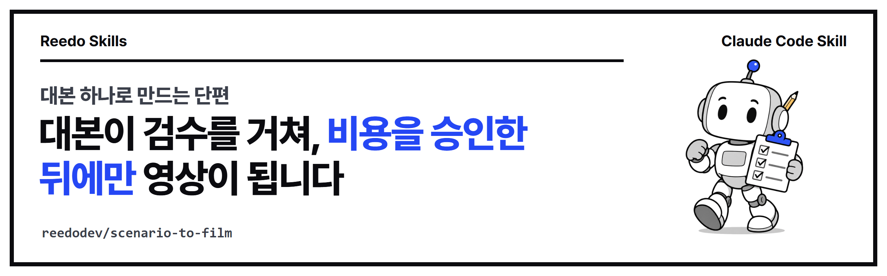

<p align="center"></p>

# 대본 하나로 만드는 검수된 단편 (scenario-to-film)

[](https://github.com/reedodev/scenario-to-film/actions/workflows/test.yml)

대본 하나를 점검하고, 샷 목록과 거친 3D 시안(프리비즈)을 거쳐, **비용을 승인한 뒤에만** 영상을 만들고 소리와 조립까지 확인하는 에이전트 스킬입니다. 돈이 나가기 전에 사용자가 직접 승인하는 관문이 두 번 있습니다.

```
대본 -> 대본 점검 -> 샷 목록 -> 기준 이미지 -> 프리비즈 (관문 1: 직접 시청)
     -> 생성 계획과 비용 (관문 2: 비용 승인) -> 샷별 생성 -> 소리 -> 조립과 검수
```

이 스킬은 스스로 크레딧을 쓰거나, 결제하거나, 게시하거나, 누구에게 연락하지 않습니다. 유료 생성과 업로드는 항상 사용자의 승인을 따로 받아야 합니다.

### 처음 오셨나요? 3분 안내

**이 스킬은 무엇을 하나요?** AI 영상은 한 장면을 만들 때마다 돈(크레딧)이 듭니다. 이 스킬은 영상을 만들기 전에 이야기를 점검하고, 값싼 시안으로 먼저 확인하게 하고, 비용표를 사용자가 "좋다"고 해야만 진짜 영상을 만들게 합니다. 만든 뒤에는 소리, 장면 이음새, 최종 파일까지 확인합니다. 개발자가 아니어도 AI 도우미에게 말로 부탁하면 됩니다.

**용어 풀이**

| 말 | 뜻 |
|---|---|
| 스킬 | AI 도우미가 읽고 따르는 작업 설명서 폴더(`SKILL.md`)입니다 |
| Claude Code | 터미널에서 대화하듯 쓰는 AI 코딩 도우미입니다 |
| 터미널 | Windows는 PowerShell, Mac은 터미널 앱입니다 |
| Node.js | 스킬 안의 검사 도구를 돌리는 프로그램입니다. 터미널에 `node -v`를 입력해 18 이상이 나오면 됩니다 |
| 샷(컷) | 끊김 없이 이어지는 영상 한 조각입니다 |
| 샷 목록 | 샷마다 길이, 카메라, 장소, 소리를 적은 표입니다 |
| 기준 이미지 | 인물과 장소의 모습을 고정하려고 먼저 만드는 그림입니다 |
| 프리비즈 | 영상을 만들기 전에 값싼 3D로 카메라와 컷 길이를 미리 보는 시안입니다 |
| 관문 | 사용자가 "좋다"고 해야 다음으로 넘어가는 멈춤 지점입니다. 시안을 본 뒤가 관문 1, 비용표를 본 뒤가 관문 2입니다 |
| 크레딧 | 영상 서비스가 받는 사용 단위(돈)입니다 |
| 지시문(프롬프트) | AI에게 무엇을 만들지 적어 주는 글입니다 |
| 자리표시 값 | `<real file>`처럼 "여기에 실제 값을 넣으세요"라는 뜻으로 남겨 둔 칸입니다. 검사기는 이것이 남아 있으면 실패합니다 |
| 이음새(매치 컷, 암전) | 두 샷이 이어지는 곳입니다. 비슷한 두 순간에서 바로 잇는 것이 매치 컷, 잠깐 어두워졌다 밝아지는 것이 암전 전환입니다 |
| 음량(LUFS) | 소리의 평균 크기를 재는 단위입니다. 이 스킬은 -14 LUFS 안팎을 기본 목표로 삼습니다 |
| 이미지로 영상(I2V), 참조로 영상(R2V), 글로 영상(T2V) | 영상 서비스가 영상을 만드는 세 방식입니다. 첫 그림을 주는지, 참조 그림을 주는지, 글만 주는지의 차이입니다. 어느 것을 쓸지는 에이전트가 계획에 적습니다 |

**끝나면 무엇이 남나요?** 대본 점검본, 샷 목록, 기준 이미지, 프리비즈 영상, 비용표, 샷별 영상, 소리, 최종 영상, 검수표(무엇을 봤고, 무엇을 쟀고, 무엇을 못 봤는지)입니다.

**막혔을 때**

| 증상 | 해결 |
|---|---|
| `node`를 찾을 수 없다고 나옵니다 | [nodejs.org](https://nodejs.org)에서 설치하거나 에이전트에게 "node가 있는지 확인해 줘"라고 합니다 |
| 검사기가 `placeholder left`라며 실패합니다 | `<...>`로 남은 칸을 실제 값으로 바꿉니다. 견본 파일만 `--allow-placeholders`를 붙입니다 |
| 영상 서비스 화면이 설명과 다릅니다 | 화면을 따르고 `references/recovery.md`를 고쳐 주세요 |
| 비용이 얼마인지 모릅니다 | 비용표에 "모름"이라고 적고 서비스 화면의 가격을 직접 확인해 적습니다. 추측으로 적지 않습니다 |
| 영상을 만들다 중간에 멈췄습니다 | 같은 요청을 다시 보내지 말고 서비스의 작업 목록에서 이미 만들어졌는지 먼저 확인합니다(다시 보내면 두 번 결제될 수 있습니다) |

## 사용 예시

이 스킬의 순서대로 만든 68초짜리 AI 단편입니다. 서울의 새벽 2시, 뉴욕을 꿈꾸던 학생이 잠들었다가 새벽 뉴욕의 고가 열차에서 눈을 뜹니다.

- 영상: [EP.01 Last Stop, First Light](https://youtu.be/gEiRXMpBjVU) (장면은 모두 Pollo AI로 만든 AI 영상입니다)
- 이 영상을 만들며 겪은 실수(비슷한 두 장면을 겹쳤더니 얼굴이 포개진 일, 나레이션이 너무 많았던 일 등)가 [`assemble-and-polish.md`](skills/scenario-to-film/references/assemble-and-polish.md)에 해결법과 함께 들어 있습니다.

### 비슷한 스킬과 무엇이 다른가요?

AI 영상용 스킬은 이미 많습니다. 대표적으로 [DirectorSKILL](https://github.com/wuwangzhang1216/DirectorSKILL)(별 253개, 2026-10-22 확인)은 감독 스타일 20종, 연속성 문서, 실패 유형 19가지, 도구별 지시문 가이드, 시험 사례가 들어 있어 **연출과 지시문 쓰기의 깊이는 이 스킬보다 훨씬 깊습니다.** 영상이 어떻게 보여야 하는지를 정교하게 짜려면 그쪽이 낫습니다.

이 스킬이 다른 점은 영상을 **만드는 과정의 안전장치**입니다. 아래는 제가 그 저장소의 SKILL.md와 README를 읽고 찾지 못한 것을 기준으로 쓴 것이며, 없다고 단정하는 것은 아닙니다.

- 돈이 나가기 전에 사용자가 직접 승인하는 관문 두 번(시안, 비용표)
- 값싼 3D 시안(프리비즈)으로 카메라와 컷 길이를 먼저 확인
- 소리 계획, 최종 파일 측정(길이, 음량, 검은 화면)과 "본 것/잰 것/못 본 것" 검수표
- 계획 파일 검사기와 자동 시험, 공모전 제출과 게시 전 점검
- 영상 한 편을 실제로 만들며 겪은 실수와 해결법

반대로 이 스킬의 약점도 분명합니다. 실제로 만든 영상은 한 편뿐이고, 연출 깊이는 얕고, 연속성 관리는 표 하나 수준입니다. 연출은 위 스킬, 비용과 검수는 이 스킬처럼 **함께 써도 됩니다.**

## 무엇이 필요한가요?

| 준비물 | 구분 | 설명 |
|---|---|---|
| `SKILL.md`를 읽는 에이전트(예: Claude Code)와 이야기 한 줄 | 필수 | 길이, 화면 비율, 등장인물 2~3명 |
| Node.js 18 이상 (22에서 시험) | 필수(검사기) | `lint-shots.mjs`, `validate-plan.mjs` |
| Python 3, Pillow, numpy, PATH의 ffmpeg | 권장 | `best-match-cut.py`가 두 장면의 가장 비슷한 순간을 찾고, 최종 파일 측정(길이, 음량, 검은 화면)에도 ffmpeg를 씁니다 |
| Blender 5.x | 권장 | 프리비즈. 대안은 CozyClay(AGPL, 별도 프로그램) |
| 영상 모델 계정(직접 비용을 내는 것) | 6단계부터 | 관문 2 전에는 아무것도 결제하지 않습니다 |

스킬이 도구를 스스로 설치하지는 않습니다. 설치하기 전에 이미 동작하는지 먼저 확인합니다.

## 바꿔 쓰기: 이렇게 말하세요

| 이렇게 말하면 | 이렇게 바뀝니다 |
|---|---|
| "대본과 샷 목록까지만" | 2단계에서 멈추고 샷 목록 검사를 돌립니다 |
| "비용표부터 보여 줘" | `assets/gen-plan-template.md`로 `gen-plan.md`를 만들고 관문 2에서 기다립니다 |
| "세로 9:16으로" | 계획의 `aspect`와 구도를 세로로 맞춥니다 |
| "두 장면이 어색해" | `best-match-cut.py`를 돌려 바로 잇기와 짧은 암전 중 고릅니다 |
| "나레이션은 줄여 줘" | `assemble-and-polish.md`의 나레이션 규칙을 적용합니다 |
| "좋은 모델로 한 컷만 먼저 비교해 줘" | 한 컷을 두 모델로 만들어 장면과 비용을 나란히 비교합니다 |

## 설치

**Claude Code 플러그인으로 설치**

```
/plugin marketplace add reedodev/scenario-to-film
/plugin install scenario-to-film@scenario-to-film
```

**폴더만 복사**

```
git clone https://github.com/reedodev/scenario-to-film.git
cp -r scenario-to-film/skills/scenario-to-film ~/.claude/skills/
```

## 바로 해 보기

에이전트에게 이렇게 말합니다. "scenario-to-film을 써 줘. 내 이야기는 이렇다: ... 20초, 16:9, 등장인물 2명, 대사 없음."

진행은 `SKILL.md`의 단계 표를 따릅니다. 사용자가 하는 일은 다음 다섯 번입니다.

1. 이야기를 알려 줍니다(1단계).
2. 대본 점검본(`script-v2.md`)과 샷 목록을 읽습니다(1b, 2단계).
3. 프리비즈를 보고 고칠 곳을 말합니다. **관문 1**입니다(3, 4단계).
4. 비용표(`gen-plan.md`)를 읽고 승인하거나 샷을 줄입니다. **관문 2**입니다(5단계).
5. 에이전트가 샷마다 생성하고 확인한 뒤 소리를 넣어 조립합니다(6~8단계).

문서와 프레임은 직접 검사해 볼 수 있습니다. 아래 명령은 **이 저장소를 받은 폴더(맨 위 폴더)에서** 그대로 실행됩니다. 다른 폴더에서 실행하려면 `skills/...` 부분을 스킬이 있는 실제 위치(예: 플러그인이나 `~/.claude/skills/`에 설치했다면 그 폴더)로 바꾸고, `shots.md`와 `plan.json` 같은 입력 파일은 명령을 실행하는 폴더에 두세요. `python`이 없으면 `python3` 또는 `py`를 쓰고, `pip install pillow numpy`가 필요할 수 있습니다.

```
node skills/scenario-to-film/scripts/lint-shots.mjs shots.md --max-seconds 20
node skills/scenario-to-film/scripts/validate-plan.mjs plan.json
python skills/scenario-to-film/scripts/best-match-cut.py clipA.mp4 clipB.mp4 --a-from 3.5
```

- `--max-seconds`는 **영화 전체 길이**의 한도입니다. 합계가 넘으면 실패하고 짧으면 통과합니다. 샷 하나는 10초를 넘을 수 없고, 계획의 클립은 3~15초여야 합니다.
- `validate-plan.mjs`는 `<real file>` 같은 자리표시 값이 남아 있으면 실패하고, 계획 옆에 없는 파일은 경고합니다. 견본(`assets/plan-template.json`)은 `--allow-placeholders`를 붙여야 통과합니다.
- 이 검사들은 문서와 프레임만 봅니다. 얼굴, 움직임, 소리는 판단하지 못하니 결과를 직접 보셔야 합니다.

## 파일

- `skills/scenario-to-film/SKILL.md`: 전체 순서와 핵심 규칙
- `skills/scenario-to-film/references/`: 대본 점검, 샷 목록, 카메라 움직임, 색감과 전환, 기준 이미지, 프리비즈 도구, 생성 계획, 비용, 소리, 검수, 문제 해결, 조립과 마무리
- `skills/scenario-to-film/assets/`: `plan-template.json`(시작용 생성 계획), `gen-plan-template.md`(관문 2의 비용표)
- `skills/scenario-to-film/scripts/`: 위의 검사 스크립트 세 개
- `tests/`, `.github/workflows/test.yml`: 시험과 자동 시험

## 시험

`node tests/run.mjs`가 SKILL.md 형식을 검사하고 세 검사기를 예시 파일로 실제 실행합니다. 푸시할 때마다 GitHub Actions가 같은 시험을 돌립니다.

## 알려진 한계

- 68초짜리 단편 한 편을 영상 플랫폼 하나와 Windows 컴퓨터 한 대에서 만들며 시험했습니다. `best-match-cut.py`의 숫자 기준(6배는 자연스럽게 이어졌고 50배는 전혀 다른 장면)은 그 한 편에서 잰 임시 값입니다.
- 설명서만 보고 따라 하는 새 사용자 시험을 세 번 했습니다. 1차(대본, 샷 목록, 생성 계획)는 5점 만점에 3점, 2차(기준 이미지, 프리비즈, 소리, 조립과 검수)는 단계별 3~4점이었고 지적받은 부분은 고쳤습니다. 3차는 고친 뒤 공개 저장소를 새로 받아 초보자 역할로 했고, 이해하기 4점·따라 하기 3점이었습니다(첫 명령의 실행 위치가 불분명한 점이 가장 컸고 이것도 고쳤습니다). 이 마지막 수정 뒤에 다시 시험해 본 것은 아닙니다. 영상 생성부터 조립까지 실제로 따라 한 사람은 저뿐이고, 프리비즈 제작과 소리 단계는 새 사용자가 시험해 본 적이 없습니다.
- 플랫폼의 동작(참조 이미지 제한, 모델 이름, 가격)은 바뀝니다. 실제 화면과 다르면 화면을 따르고 `references/recovery.md`를 고쳐 주세요.
- 소리는 수치 측정과 받아쓰기로만 확인했고 사람이 귀로 듣고 검수한 것이 아닙니다. 게시하기 전에 직접 들어 보세요.

## 출처와 영감

방법의 아이디어를 다음 프로젝트에서 참고했습니다. 코드나 글을 옮기지 않았습니다.

- [Scenario Agent Skills](https://github.com/scenario-labs/skills) (MIT): 프리비즈 방식
- [Drama Skills (zenstory-ai)](https://github.com/zenstory-ai/drama-skills) (MIT): 대본과 샷 구성
- [REA (morluto)](https://github.com/morluto/rea) (MIT): 스킬 구조만 참고
- [CozyClay (NomaDamas)](https://github.com/NomaDamas/CozyClay) (AGPL-3.0-or-later): 별도 프로그램으로만 쓰며 코드와 글은 이 저장소에 없습니다
- [Flagship Scene UI](https://github.com/ych8836-ops/flagship-scene-ui-native) (AGPL-3.0): 장면·클립 계획의 아이디어만 참고했고 도구는 쓰지 않았습니다

카메라 움직임과 전환 목록은 `references/sources.md`에 적은 공개 글들을 읽고 직접 요약한 것입니다. ffmpeg, Pillow, numpy는 각자의 라이선스를 따르는 외부 도구입니다.

## 만든 사람

**리도**, AI 좌충우돌 실습 중인 20년차 엔지니어입니다. 영상을 만들어 보며 막힌 부분을 고쳐 가며 이 스킬을 만들었습니다. [YouTube @Reedodev](https://www.youtube.com/@Reedodev) · [Threads @reedo.dev](https://www.threads.com/@reedo.dev) · [GitHub @reedodev](https://github.com/reedodev)

같이 만든 다른 스킬: [설명 영상 만들기](https://github.com/reedodev/explainer-studio) · [옵시디언 3D 지식그래프](https://github.com/reedodev/obsidian-brain-3d) · [TTS 끝소리 고치기](https://github.com/reedodev/tts-tail-fix) · [영상 비율 검사](https://github.com/reedodev/social-video-gate) · [유튜브 게시 점검](https://github.com/reedodev/youtube-publish-checklist) · [카드뉴스 렌더](https://github.com/reedodev/html-card-render) · [스킬 목록](https://github.com/reedodev/reedo-skills)

---

## English

# scenario-to-film

An agent skill that turns one script into a checked short film or ad. It reviews the script, builds a shot list and a rough 3D previs, and generates video **only after you approve the cost**. Two approval gates come before any money is spent.

```
script -> script doctor -> shot list -> reference stills -> previs (gate 1: you watch)
       -> generation plan + cost (gate 2: you approve) -> generate shot by shot -> sound -> assemble + QA
```

The skill never spends credits, pays, posts or contacts anyone by itself. Every paid generation and every upload still needs your own approval.

### New here? A three-minute guide

**What does this skill do?** AI video costs money (credits) for every shot. This skill reviews your story first, has you check a cheap rough version, and only generates real video after you approve a cost table. After generation it checks sound, cut junctions and the final file. You do not need to be a developer: ask your AI assistant in plain language.

**Glossary**

| Term | Meaning |
|---|---|
| Skill | A folder of instructions (`SKILL.md`) that your AI assistant reads and follows |
| Claude Code | An AI coding assistant you talk to inside a terminal |
| Terminal | PowerShell on Windows, the Terminal app on macOS |
| Node.js | Runs the checking tools in the skill. Type `node -v`; 18 or higher is fine |
| Shot (cut) | One continuous piece of video |
| Shot list | A table with length, camera, place and sound for every shot |
| Reference image | A still made first to lock how a character or place looks |
| Previs | A cheap rough 3D version that shows camera moves and cut timing before you pay for video |
| Gate | A stop where you must say "yes" before the work continues: gate 1 after the previs, gate 2 after the cost table |
| Credits | The unit (money) a video service charges |
| Prompt | The text that tells the AI what to make |
| Placeholder | A value like `<real file>` left to mean "put the real value here". The checker fails while any is left |
| Cut junction (match cut, dip to black) | Where two shots meet. A match cut joins two near-identical moments directly; a dip to black fades out and back in |
| Loudness (LUFS) | The unit for average sound level. This skill defaults to about -14 LUFS |
| I2V, R2V, T2V | The three ways a video service makes a clip: from a first image, from reference images, or from text only. The agent writes which one it uses in the plan |

**What do you end up with?** A reviewed script, a shot list, reference images, a previs video, a cost table, shot clips, sound, the final video and a QA table (what was seen, what was measured, what was not checked).

**When you get stuck**

| Symptom | Fix |
|---|---|
| `node` is not found | Install it from [nodejs.org](https://nodejs.org), or ask the agent "check whether node is installed" |
| The checker fails with `placeholder left` | Replace every leftover `<...>` with a real value. Only the template file takes `--allow-placeholders` |
| The video service looks different from the description | Follow the screen and update `references/recovery.md` |
| You do not know the cost | Write "unknown" in the cost table, read the price on the service's screen and fill it in. Never guess |
| A generation stopped halfway | Do not resend the same request. Check the service's job list first; a resend can be charged twice |

### Example

A 68-second AI short made with this skill's steps: a student in Seoul at 2 a.m. falls asleep dreaming of New York and wakes on an elevated train at dawn.

- Video: [EP.01 Last Stop, First Light](https://youtu.be/gEiRXMpBjVU) (every shot generated with Pollo AI)
- The mistakes made along the way (dissolving two near-identical shots made faces overlap; too much narration) are in [`assemble-and-polish.md`](skills/scenario-to-film/references/assemble-and-polish.md) with the fixes.

### How is this different from similar skills?

There are already many AI-video skills. [DirectorSKILL](https://github.com/wuwangzhang1216/DirectorSKILL) (253 stars, checked 2026-10-22), for example, ships 20 director-style overlays, a continuity bible, 19 coded failure types, per-tool prompt adapters and evals, so **its depth in directing and prompt writing is far greater than this skill's.** If you want to design how a film should look, use that one.

What this skill adds is **safeguards around the making**. The list below is based on what I did not find in that repository's SKILL.md and README; it is not a claim that it has none.

- Two approval gates before any money is spent (the previs, the cost table)
- A cheap 3D previs to check camera and cut timing first
- A sound plan, measurements of the final file (length, loudness, black frames) and a "seen / measured / not checked" QA table
- Checkers for the plan file with automated tests, plus contest entry and pre-publish checks
- Mistakes and fixes from actually making one film

The weaknesses are just as clear: only one film has been made with it, the directing depth is shallow, and continuity tracking is a single table. You can use both: that skill for directing, this one for cost control and QA.

### Requirements

| Need | Level | Notes |
|---|---|---|
| An agent that reads `SKILL.md` (for example Claude Code) and a story idea | required | Length, aspect ratio, 2-3 people |
| Node.js 18 or newer (tested with 22) | required for the checkers | `lint-shots.mjs`, `validate-plan.mjs` |
| Python 3, Pillow, numpy, ffmpeg on PATH | recommended | `best-match-cut.py` finds the best frame pair for a cut; ffmpeg also measures the final file (length, loudness, black frames) |
| Blender 5.x | recommended | Previs; the alternative is CozyClay (AGPL, separate program) |
| A video model account you pay for | optional until step 6 | Nothing paid runs before gate 2 |

The skill installs nothing itself. It checks whether a tool already runs before suggesting an install.

### Say it this way to change it

| You say | The skill does |
|---|---|
| "Only the script and shot list" | Stops after step 2 and runs the shot-list check |
| "Show me the cost table first" | Builds `gen-plan.md` from `assets/gen-plan-template.md` and waits at gate 2 |
| "Make it vertical 9:16" | Sets `aspect` in the plan and frames for vertical |
| "Two clips look wrong together" | Runs `best-match-cut.py`, then picks a hard cut or a dip to black |
| "Less narration" | Applies the narration rules in `assemble-and-polish.md` |
| "Compare the better model on one shot first" | Makes one shot on two models and compares frames and cost |

### Install

**As a Claude Code plugin**

```
/plugin marketplace add reedodev/scenario-to-film
/plugin install scenario-to-film@scenario-to-film
```

**Or copy the folder**

```
git clone https://github.com/reedodev/scenario-to-film.git
cp -r scenario-to-film/skills/scenario-to-film ~/.claude/skills/
```

### Quick start

Tell your agent: "Use scenario-to-film. My story: ... 20 seconds, 16:9, two people, no dialogue."

The agent follows the step table in `SKILL.md`. You do five things:

1. Give the story (step 1).
2. Read the reviewed script (`script-v2.md`) and the shot list (steps 1b and 2).
3. Watch the previs and say what to change. This is **gate 1** (steps 3 and 4).
4. Read the cost table (`gen-plan.md`) and approve it or cut shots. This is **gate 2** (step 5).
5. The agent generates shot by shot, checks each clip, adds sound and assembles (steps 6 to 8).

Check the documents and frames yourself. The commands below run as written **from the top folder of this repository**. To run them from another folder, replace the `skills/...` part with where the skill actually is (for example the plugin folder or `~/.claude/skills/`), and keep input files such as `shots.md` and `plan.json` in the folder you run from. If `python` is missing use `python3` or `py`, and you may need `pip install pillow numpy`.

```
node skills/scenario-to-film/scripts/lint-shots.mjs shots.md --max-seconds 20
node skills/scenario-to-film/scripts/validate-plan.mjs plan.json
python skills/scenario-to-film/scripts/best-match-cut.py clipA.mp4 clipB.mp4 --a-from 3.5
```

- `--max-seconds` is the limit for the **whole film**. A longer total fails, a shorter one passes. One shot may not exceed 10 s and a plan clip must be 3-15 s.
- `validate-plan.mjs` fails on placeholders such as `<real file>` and warns about files that do not exist next to the plan. The template needs `--allow-placeholders`.
- These checks look at documents and frames only. They cannot judge faces, motion or sound. Look at the result yourself.

### Files

- `skills/scenario-to-film/SKILL.md`: the pipeline and core rules
- `skills/scenario-to-film/references/`: script doctor, shot list, camera moves, look and transitions, reference images, previs tools, generation plan, cost, sound, QA, recovery, assemble and polish
- `skills/scenario-to-film/assets/`: `plan-template.json` (starting plan) and `gen-plan-template.md` (the cost table for gate 2)
- `skills/scenario-to-film/scripts/`: the three checkers above
- `tests/` and `.github/workflows/test.yml`: tests and CI

### Tests

`node tests/run.mjs` lints `SKILL.md` and runs the three checkers on small fixtures. GitHub Actions runs the same test on every push.

### Known limits

- Tested on one 68-second film, one video platform and one Windows machine. The thresholds in `best-match-cut.py` (about 6x cut cleanly, about 50x was an unrelated shot) come from that one film and are provisional.
- Three documentation-only trials by fresh users: the first (script, shot list, generation plan) rated 3 of 5; the second (reference stills, previs, sound, assemble and QA) rated 3 to 4 per step, and its points were fixed. The third was a beginner persona on a fresh clone of the public repository: understanding 4 of 5, following along 3 of 5 (the biggest problem was that it was unclear where to run the first command, which is now fixed). Nobody re-ran the trial after that last fix. Only the author has followed generation through assembly, and no fresh user has tried building a previs or the sound step.
- Platform behavior (reference limits, model names, prices) changes. Follow the live UI and update `references/recovery.md` when it differs.
- Sound was checked by measurement and transcription, not by a trained listener. Listen before you publish.

### Credits

Method ideas were drawn from these projects. No code or text was copied.

- [Scenario Agent Skills](https://github.com/scenario-labs/skills) (MIT): previs approach
- [Drama Skills by zenstory-ai](https://github.com/zenstory-ai/drama-skills) (MIT): script and shot structure
- [REA by morluto](https://github.com/morluto/rea) (MIT): skill structure only
- [CozyClay by NomaDamas](https://github.com/NomaDamas/CozyClay) (AGPL-3.0-or-later): used only as a separate program; none of its code or text is here
- [Flagship Scene UI](https://github.com/ych8836-ops/flagship-scene-ui-native) (AGPL-3.0): scene and clip plan ideas only; the tool is not used

The camera-move and transition lists are my own summaries of the public pages listed in `references/sources.md`. ffmpeg, Pillow and numpy are external tools under their own licenses.

MIT License; third-party tools keep their own licenses.
